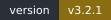
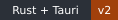
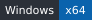
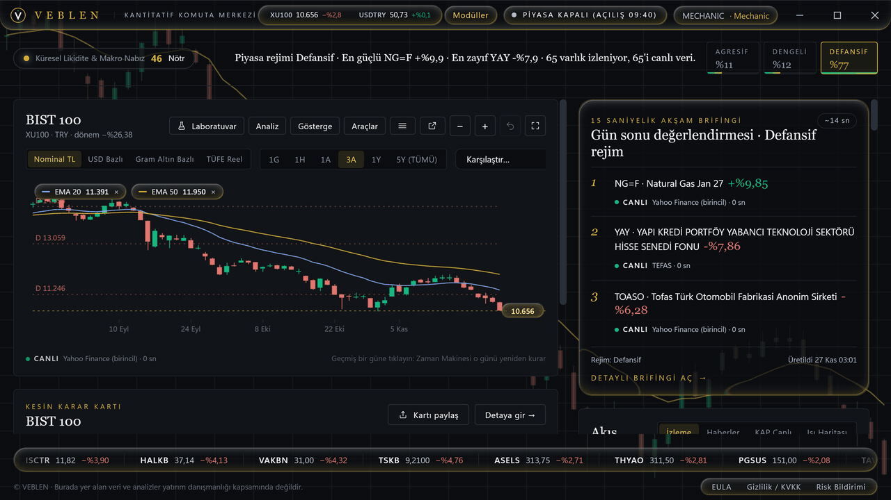
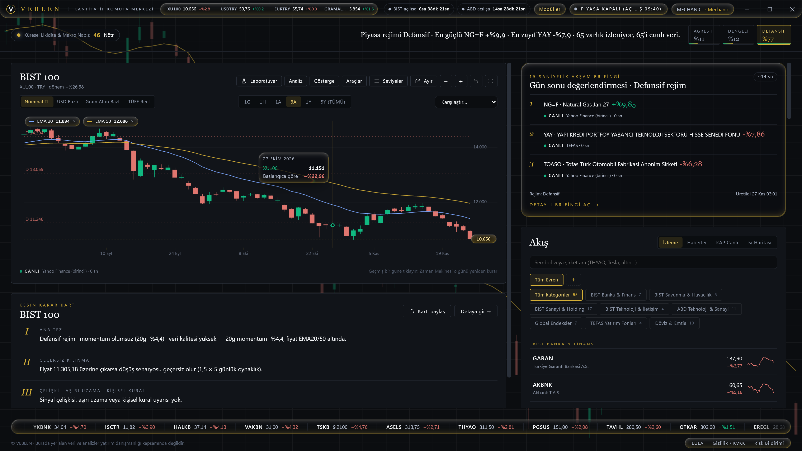
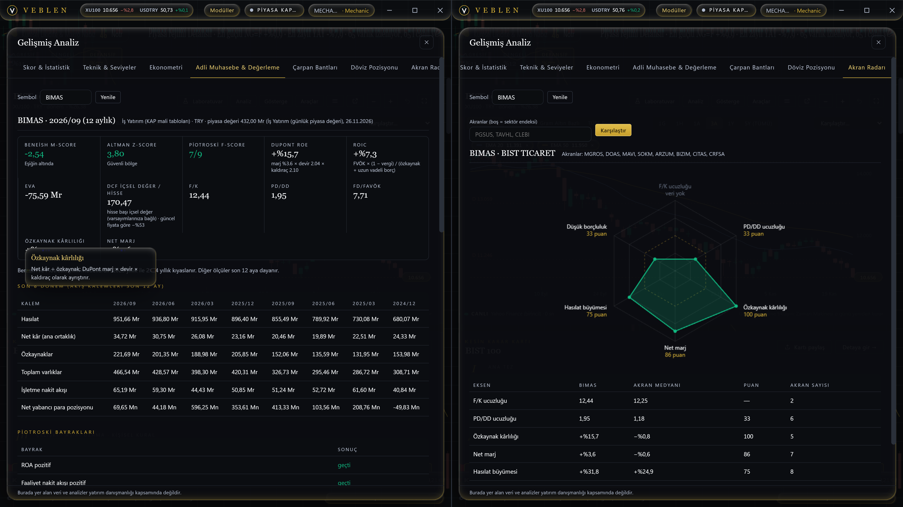
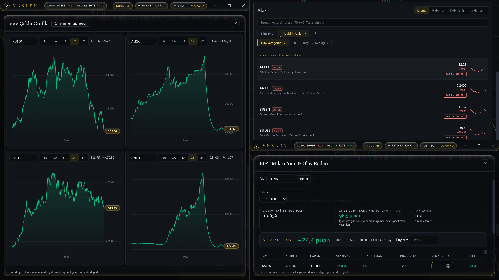
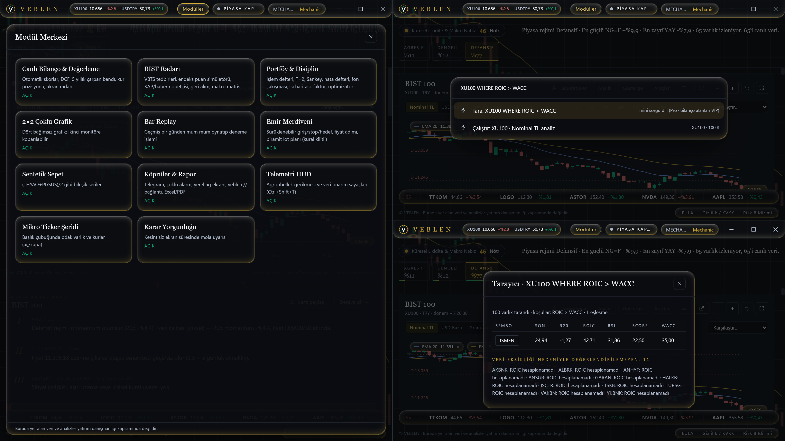

<div align="center">

[🇹🇷 Türkçe İnceleme](README.tr.md)

# VEBLEN

**A quantitative terminal for Borsa İstanbul, global markets and Turkish funds — native, local-first, and built from real glass.**






<a href="https://itsemreyldz.github.io/veblen-releases/"></a>

### [⬇ Download for Windows — v3.2.1](https://github.com/itsemreyldz/veblen-releases/releases/download/v3.2.1/VEBLEN_3.2.1_x64-setup.exe)

[Live site](https://itsemreyldz.github.io/veblen-releases/) · [Release notes](https://github.com/itsemreyldz/veblen-releases/releases/tag/v3.2.1) · [Liquid Glass demo](https://itsemreyldz.github.io/veblen-releases/liquid-glass/)

</div>

> **Before you download:** VEBLEN is commercial software and needs an access key. The interface is in **Turkish**. Nothing in it is investment advice, and it does not place orders.

## Why VEBLEN?

| | **VEBLEN** | Typical Electron / web terminal |
|---|---|---|
| Engine | Rust core + the WebView2 runtime Windows already provides | Ships its own Chromium and Node.js, or lives in a browser tab |
| Installer | **6.4 MB** | Has to carry a browser engine |
| Memory, dashboard open on live data | **192 MB** (private working set, 7 processes; 180 MB minimised) | Not benchmarked here |
| Launch to first paint | **≈ 1.10 s** (warm disk cache) | Not benchmarked here |
| Statement verification (BIST industrials) | Two sources cross-checked. If a year-end column sits on a different inflation-accounting (TMS 29) basis than the interim columns, the source is switched and the screen says so. Figures are never rescaled | Depends on the data vendor |
| Your records | Portfolio, trade ledger and notes in a local SQLite database | Depends on the product |

<sub>VEBLEN figures are measurements of v3.2.1 on 27 November 2026 (AMD Ryzen 5 5600X 6-Core Processor, 32 GB RAM, Windows 11 Pro): memory is the private working set of VEBLEN and its WebView2 child processes 60 seconds after the dashboard settles; first paint is the median of five launches without a reboot, taken on a test build of the same code. Other products were not benchmarked, so no numbers are claimed for them.</sub>

## New in v3.2

| Area | What it does | Where the numbers come from |
|---|---|---|
| Inflation & purchasing power | Official CPI and household-basket nowcasts with an out-of-sample backtest, price-shock simulator, break-even line, DRIP, real-wealth cone, FIRE date | TCMB CPI table, Eurostat sub-indices for Türkiye, USD/TRY and Brent |
| BIST intelligence | Foreign-ownership flow, same-time-slot volume anomalies, IPO and index-change screens, sector rotation, rate sensitivity | İş Yatırım, KAP, TCMB, Yahoo Finance |
| Derivatives & relative value | Futures basis, option chain with IV and max pain, margin-call price, gold/silver spread, pairs, lead-lag | Public VİOP and metal quotes |
| Forensics & family office | Accruals, cash cycle, reverse DCF, FX sensitivity, fund look-through, Brinson attribution, buy-only rebalancing, historical stress | Published statements and price history, plus your own holdings |
| Operations | Sealed investment theses, walk-forward lab, rule scanner, paper trading, weekly PDF, encrypted `.veblen` workspace, privacy lock | Local SQLite |

**v3.2.1** adds a data-source health badge in the title bar, a discipline lock that also guards the trade ledger and the order ladder, a read-only sample fund tour in every package, walk-forward tests for EMA, MACD, Bollinger and multi-factor rules, and fund holdings read automatically from KAP monthly reports (checked against each report’s own totals; CSV/JSON paste when a layout is not recognised).

<sub>Some data has no free public source (broker distribution, order-book depth, debt maturity footnotes, option open interest, CDS). Those screens work on what you enter, and say so; nothing is invented.</sub>

## Four engines

<table>
<tr>
<td width="50%" valign="top"><a href="assets/hero-liquid-glass.png"></a><br><b>1 · Liquid Glass command centre</b><br>Live chart, decision card and briefing under optical glass: sharp in the middle, refracting at the edges, switched off in low-power mode.</td>
<td width="50%" valign="top"><a href="assets/forensics-xray.png"></a><br><b>2 · Forensics &amp; valuation</b><br>Beneish, Altman, Piotroski, DuPont, ROIC vs WACC and DCF filled from published statements, with Hover X-Ray explanations and a 6-axis sector peer radar.</td>
</tr>
<tr>
<td width="50%" valign="top"><a href="assets/bist-radar-grid.png"></a><br><b>3 · BIST microstructure radar</b><br>2×2 chart grid, exchange volatility-measure (VBTS) badges from public disclosures, index point-contribution simulator, news sentinel and buyback tracker.</td>
<td width="50%" valign="top"><a href="assets/command-palette.png"></a><br><b>4 · Command language</b><br><code>Ctrl+K</code> screens such as <code>XU100 WHERE ROIC &gt; WACC</code> or <code>XU030 WHERE PIOTROSKI &gt;= 7 AND FK &lt; 10</code>, next to the Module Centre.</td>
</tr>
</table>

<sub>Screenshots are taken from the running app on live public data of the capture day. Multi-panel images place several screens of the same app side by side.</sub>

## 🧊 Take the glass with you

> **[`liquid-glass/`](liquid-glass/) — zero-blur refraction in two small files, MIT licensed.**
> An SVG `feDisplacementMap` lens with chromatic edge and specular rim. Copy `liquid-glass.css` and `glass.js`, add `data-liquid-glass` to an element, done.
> **[Try the live demo →](https://itsemreyldz.github.io/veblen-releases/liquid-glass/)** · [Read how it works](liquid-glass/README.md)
> If it is useful to you, a ⭐ helps others find it.

## Install

1. **[Download `VEBLEN_3.2.1_x64-setup.exe`](https://github.com/itsemreyldz/veblen-releases/releases/download/v3.2.1/VEBLEN_3.2.1_x64-setup.exe)** (Windows 10 / 11, x64).
2. Verify the file before running it:

```powershell
Get-FileHash .\VEBLEN_3.2.1_x64-setup.exe -Algorithm SHA256
```

The result must be (letter case does not matter):

```text
59df1b6a2c055c343f4bea56dd400d185bc40646d934ca7b1f372673fe2ed881
```

> **Windows SmartScreen:** Windows shows this warning for software that is not yet widely recognised; you can install it with **More info → Run anyway**. Do that only after the fingerprint above matches.

3. Enter your access key (`VBLN-…`) and accept the terms. To request a key, [open a request](https://github.com/itsemreyldz/veblen-releases/issues/new?title=Access%20key%20request).

**Good to know:** one key binds to one computer (you can reset it yourself twice a year) · works from cache without internet, with the licence re-checked at least every 72 hours · updates install only if their signature verifies.

**Network and data:** your portfolio, ledger, notes and settings stay on your computer. The app connects to public market-data sources, to GitHub for updates, and to the licence server, which receives a hash of your key and a hashed device identifier. Optional bridges (for example Telegram) are off until you turn them on.

## Licence

VEBLEN is proprietary software. The MIT licence applies **only** to the [`liquid-glass/`](liquid-glass/) folder.

---

<sub>The data and analyses shown are not investment advice.</sub>
