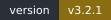
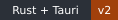
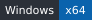
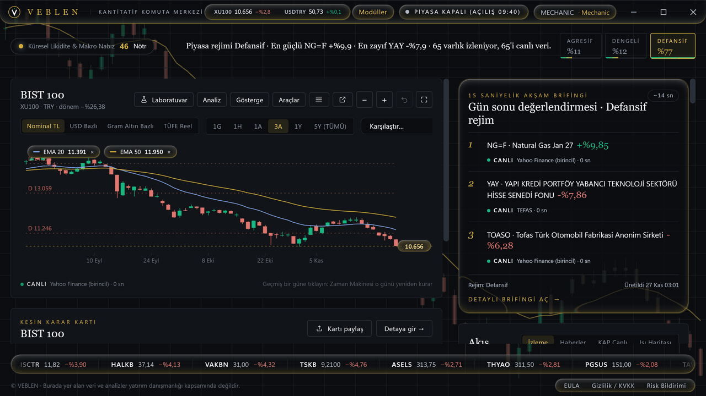
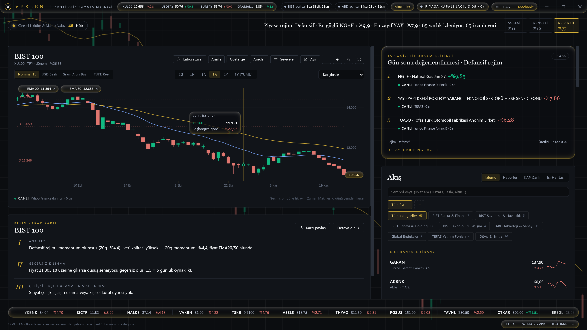
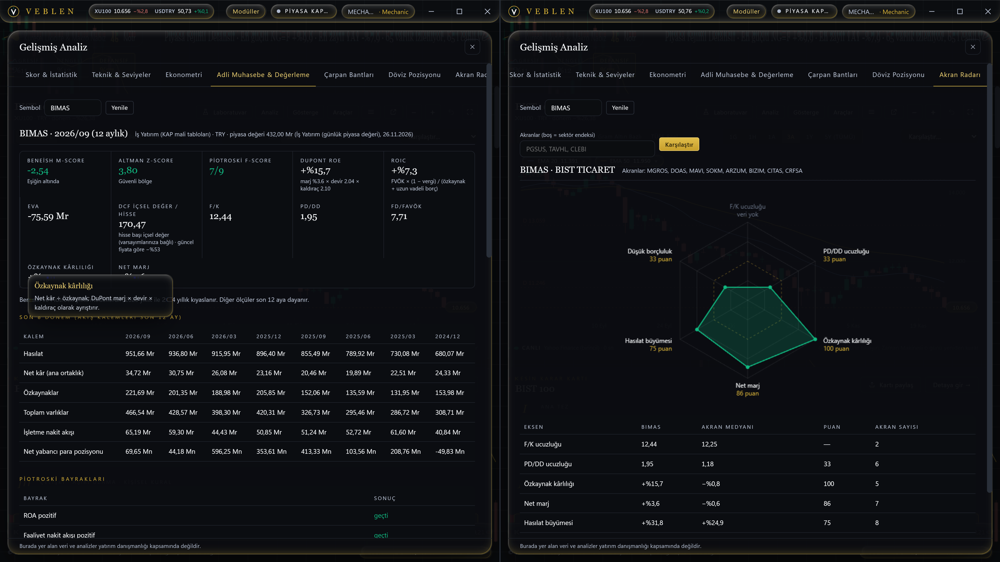
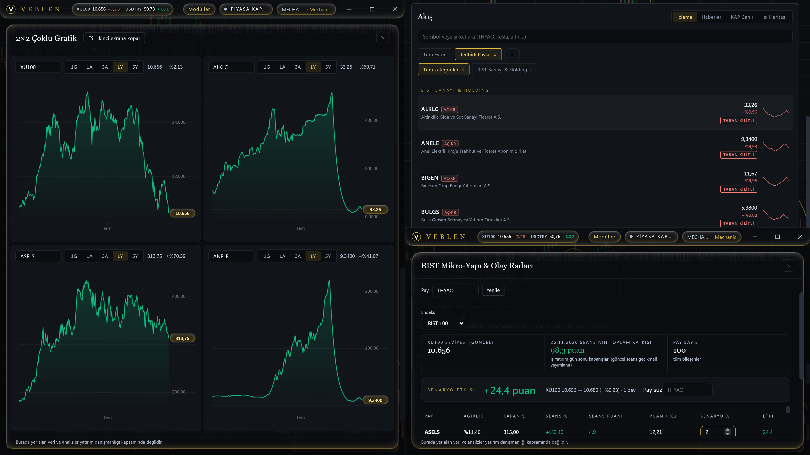
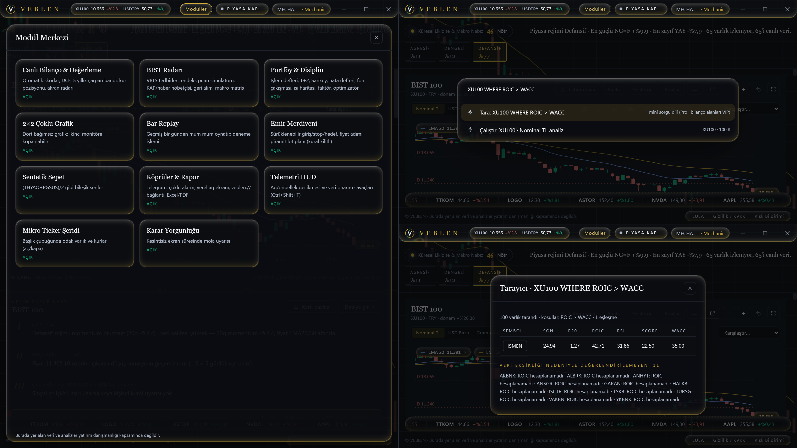

<div align="center">

[🇬🇧 English](README.md)

# VEBLEN

**Borsa İstanbul, küresel piyasalar ve TEFAS için kantitatif terminal — yerel, hızlı ve gerçek camdan.**






<a href="https://itsemreyldz.github.io/veblen-releases/tr.html"></a>

### [⬇ Windows için indir — v3.2.1](https://github.com/itsemreyldz/veblen-releases/releases/download/v3.2.1/VEBLEN_3.2.1_x64-setup.exe)

[Ürün sayfası](https://itsemreyldz.github.io/veblen-releases/tr.html) · [Sürüm notları](https://github.com/itsemreyldz/veblen-releases/releases/tag/v3.2.1) · [Liquid Glass demosu](https://itsemreyldz.github.io/veblen-releases/liquid-glass/)

</div>

> **İndirmeden önce:** VEBLEN ticari bir yazılımdır ve erişim anahtarı ister. Arayüz **Türkçedir**. İçindeki hiçbir veri yatırım danışmanlığı değildir; uygulama emir göndermez.

## Neden VEBLEN?

| | **VEBLEN** | Tipik Electron / web terminali |
|---|---|---|
| Motor | Rust çekirdeği + Windows'un hazır sunduğu WebView2 | Kendi Chromium ve Node.js'ini taşır ya da tarayıcı sekmesinde yaşar |
| Kurulum paketi | **6,4 MB** | Tarayıcı motorunu da taşımak zorunda |
| Bellek, komuta ekranı canlı veriyle açık | **192 MB** (özel çalışma kümesi, 7 süreç; küçültülmüşken 180 MB) | Burada ölçülmedi |
| Başlatmadan ilk görüntüye | **≈ 1,10 sn** (sıcak disk önbelleği) | Burada ölçülmedi |
| Bilanço doğrulaması (BIST sanayi) | İki kaynak karşılaştırılır. Yıl sonu sütunu ara dönemlerden farklı bir enflasyon muhasebesi (TMS 29) tabanındaysa kaynak değiştirilir ve ekranda belirtilir. Tutarlar asla yeniden ölçeklenmez | Veri sağlayıcısına bağlı |
| Kayıtlarınız | Portföy, işlem defteri ve notlar bilgisayarınızdaki SQLite veritabanında | Ürüne bağlı |

<sub>VEBLEN değerleri v3.2.1 sürümünün 27 Kasım 2026 tarihli ölçümleridir (AMD Ryzen 5 5600X 6-Core Processor, 32 GB RAM, Windows 11 Pro): bellek, VEBLEN ve WebView2 alt süreçlerinin özel çalışma kümesidir (komuta ekranı oturduktan 60 sn sonra); ilk görüntü, yeniden başlatma yapılmadan beş açılışın ortancasıdır ve aynı kodun sınama derlemesinde ölçülmüştür. Başka ürünler ölçülmediği için onlar adına sayı verilmez.</sub>

## v3.2 ile gelenler

| Alan | Ne yapar | Sayıların kaynağı |
|---|---|---|
| Enflasyon ve alım gücü | Resmî TÜFE ve gündelik sepet tahmini (örneklem dışı sınama ile), zam/kur şoku simülatörü, başabaş çizgisi, DRIP, reel servet konisi, FIRE tarihi | TCMB TÜFE tablosu, Eurostat Türkiye alt endeksleri, USD/TL ve Brent |
| BIST istihbaratı | Yabancı oranı akışı, aynı saat dilimine göre hacim anomalisi, halka arz ve endeks değişim taraması, sektör rotasyonu, faiz duyarlılığı | İş Yatırım, KAP, TCMB, Yahoo Finance |
| Türev ve göreli değer | Vadeli baz, IV ve Max Pain’li opsiyon zinciri, teminat tamamlama fiyatı, altın/gümüş makası, ikili işlem, lead-lag | Herkese açık VİOP ve maden kotasyonları |
| Adli bilanço ve aile ofisi | Tahakkuk, nakit döngüsü, tersine İNA, kur hassasiyeti, fon içi görünüm, Brinson atfı, satışsız dengeleme, tarihsel stres | Yayımlanan tablolar ve fiyat geçmişi ile sizin varlıklarınız |
| Operasyon | Mühürlü yatırım tezi, walk-forward, kural tarayıcısı, kâğıt işlem, haftalık PDF, şifreli `.veblen` çalışma alanı, gizlilik kilidi | Yerel SQLite |

**v3.2.1** ile üst çubukta veri kaynağı sağlığı rozeti, İşlem Defteri ve Emir Merdiveni’ni de koruyan disiplin kilidi, her pakette salt-okunur örnek fon turu, EMA, MACD, Bollinger ve çoklu faktör kuralları için walk-forward sınaması ve KAP aylık raporlarından otomatik fon dağılımı (raporun kendi toplamıyla doğrulanır; tanınmayan düzende CSV/JSON yapıştırma) geldi.

<sub>Bazı verilerin ücretsiz kaynağı yoktur (aracı kurum dağılımı, emir defteri derinliği, borç vade dipnotu, opsiyon açık pozisyonu, CDS). Bu ekranlar sizin girdiğiniz veriyle çalışır ve bunu belirtir; hiçbir sayı uydurulmaz.</sub>

## Dört motor

<table>
<tr>
<td width="50%" valign="top"><a href="assets/hero-liquid-glass.png"></a><br><b>1 · Liquid Glass komuta merkezi</b><br>Canlı grafik, karar kartı ve brifing optik cam altında: ortası net, kenarı kırıcı; düşük güç modunda tümüyle kapanır.</td>
<td width="50%" valign="top"><a href="assets/forensics-xray.png"></a><br><b>2 · Adli muhasebe ve değerleme</b><br>Beneish, Altman, Piotroski, DuPont, ROIC-WACC ve DCF yayımlanan tablolardan otomatik dolar; Hover X-Ray açıklamaları ve 6 eksenli sektör akran radarı.</td>
</tr>
<tr>
<td width="50%" valign="top"><a href="assets/bist-radar-grid.png"></a><br><b>3 · BIST mikro yapı radarı</b><br>2×2 çoklu grafik, KAP duyurularından VBTS tedbir rozetleri, endeks puan katkı simülatörü, haber nöbetçisi ve geri alım takibi.</td>
<td width="50%" valign="top"><a href="assets/command-palette.png"></a><br><b>4 · Komut dili</b><br><code>Ctrl+K</code> ile <code>XU100 WHERE ROIC &gt; WACC</code> ya da <code>XU030 WHERE PIOTROSKI &gt;= 7 AND FK &lt; 10</code> gibi taramalar ve Modül Merkezi.</td>
</tr>
</table>

<sub>Görüntüler çalışan uygulamadan, çekim gününün canlı ve herkese açık verisiyle alınmıştır. Çok panelli görseller aynı uygulamanın farklı ekranlarını yan yana gösterir.</sub>

## 🧊 Camı projenize alın

> **[`liquid-glass/`](liquid-glass/) — iki küçük dosyada bulanıklıksız kırılma, MIT lisanslı.**
> Renk ayrışmalı kenar ve parlak çerçeveli SVG `feDisplacementMap` merceği. `liquid-glass.css` ile `glass.js` dosyalarını kopyalayın, bir öğeye `data-liquid-glass` ekleyin; hazır.
> **[Canlı demoyu deneyin →](https://itsemreyldz.github.io/veblen-releases/liquid-glass/)** · [Nasıl çalışır (İngilizce)](liquid-glass/README.md)
> İşinize yararsa bir ⭐ başkalarının da bulmasını sağlar.

## Kurulum

1. **[`VEBLEN_3.2.1_x64-setup.exe` dosyasını indirin](https://github.com/itsemreyldz/veblen-releases/releases/download/v3.2.1/VEBLEN_3.2.1_x64-setup.exe)** (Windows 10 / 11, x64).
2. Çalıştırmadan önce dosyayı doğrulayın:

```powershell
Get-FileHash .\VEBLEN_3.2.1_x64-setup.exe -Algorithm SHA256
```

Sonuç şu olmalıdır (büyük/küçük harf fark etmez):

```text
59df1b6a2c055c343f4bea56dd400d185bc40646d934ca7b1f372673fe2ed881
```

> **Windows SmartScreen:** Windows bu uyarıyı henüz yeterince tanınmayan yazılımlarda gösterir; **Ek Bilgi → Yine de Çalıştır** adımıyla kurabilirsiniz. Bunu yalnız yukarıdaki parmak izi eşleştikten sonra yapın.

3. `VBLN-…` erişim anahtarınızı girin ve koşulları onaylayın. Anahtar için [talep açın](https://github.com/itsemreyldz/veblen-releases/issues/new?title=Satın%20alma%20talebi).

**Bilmeniz iyi olur:** bir anahtar bir bilgisayara bağlanır (yılda iki kez kendiniz sıfırlayabilirsiniz) · internet yokken önbellekten çalışır, lisans en geç 72 saatte bir yeniden doğrulanır · güncellemeler yalnız imzası doğrulanırsa kurulur.

**Ağ ve veri:** portföyünüz, defteriniz, notlarınız ve ayarlarınız bilgisayarınızda kalır. Uygulama herkese açık piyasa veri kaynaklarına, güncelleme için GitHub'a ve lisans sunucusuna bağlanır; lisans sunucusu anahtarınızın özetini ve özetlenmiş cihaz kimliğini alır. İsteğe bağlı köprüler (ör. Telegram) siz açana kadar kapalıdır.

## Lisans

VEBLEN tescilli bir yazılımdır. MIT lisansı **yalnız** [`liquid-glass/`](liquid-glass/) klasörü için geçerlidir.

---

<sub>Burada yer alan veri ve analizler yatırım danışmanlığı kapsamında değildir.</sub>
